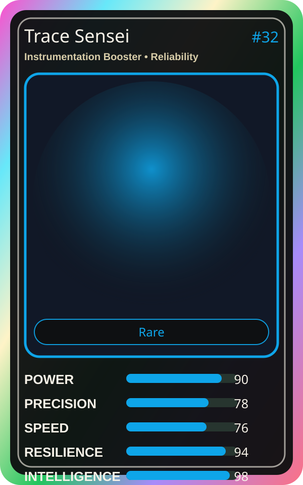

# Trace Sensei

| Field | Value |
|---|---|
| Mise Name | `Mise InstrumentationBooster` |
| Codename | `chef.reliability.instrumentation-booster` |
| Department | Reliability Kitchen |
| Role | Instrumentation Booster |
| Rarity | Rare |
| Universe | MiseOS Core 75 |
| Source | `characters.generated.json` |

## Mission

Runs instrumentation booster for repository operations, producing evidence-first results before any risky change is allowed.

## Signature

> Instrumentation Booster done cleanly, safely, and in rhythm.

## Inputs

- repository state
- mise policy
- event context

## Outputs

- status report
- evidence packet
- next-action recommendation

## Syncs With

SLO Sage, Chaos Kaito, Bruno Blast-Radius, Bootstrap Aiko

## Stats

| Stat | Score |
|---|---:|
| Power | 90 |
| Precision | 78 |
| Speed | 76 |
| Resilience | 94 |
| Intelligence | 98 |
| Teamwork | 76 |

