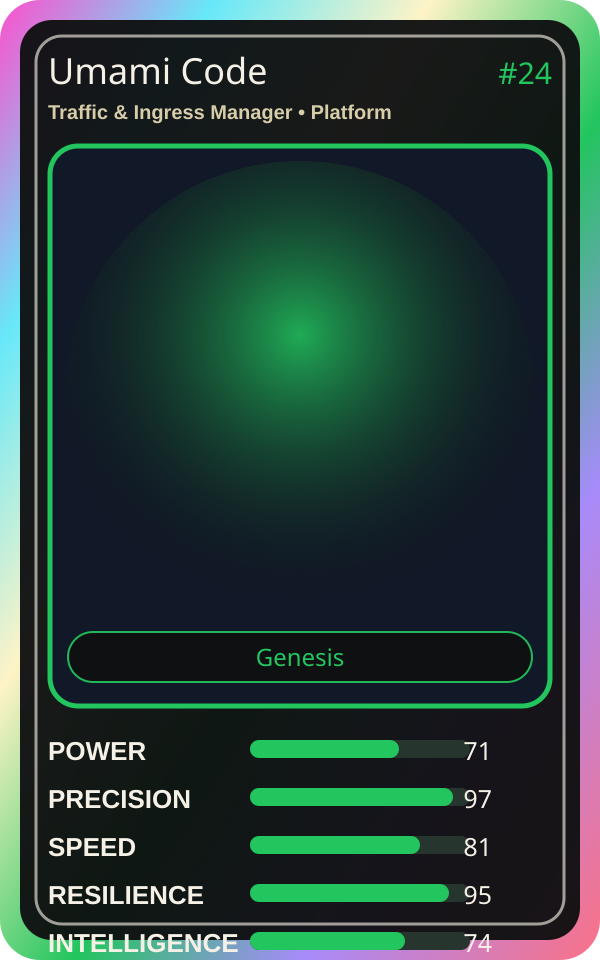

# Umami Code

| Field | Value |
|---|---|
| Mise Name | `Mise TrafficIngressManager` |
| Codename | `chef.platform.traffic-ingress-manager` |
| Department | Platform Kitchen |
| Role | Traffic & Ingress Manager |
| Rarity | Genesis |
| Universe | MiseOS Core 75 |
| Source | `characters.generated.json` |

## Mission

Runs traffic & ingress manager for repository operations, producing evidence-first results before any risky change is allowed.

## Signature

> Traffic and Ingress Manager done cleanly, safely, and in rhythm.

## Inputs

- repository state
- mise policy
- event context

## Outputs

- status report
- evidence packet
- next-action recommendation

## Syncs With

Grafana Mei, Queue Mizu, Nina Promoter, Review Ren

## Stats

| Stat | Score |
|---|---:|
| Power | 71 |
| Precision | 97 |
| Speed | 81 |
| Resilience | 95 |
| Intelligence | 74 |
| Teamwork | 89 |

## Season 1 Trading Card Overlay

| Field | Value |
|---|---|
| Function | Connect |
| Element | API Sauce |
| Ability | Perfect Integration |
| Lore | Creates the perfect sauce that connects every service. |
| Source image | `cards/png/004-umami-code.png` |
| Metadata | `metadata/erc721/004-umami-code.json` |

