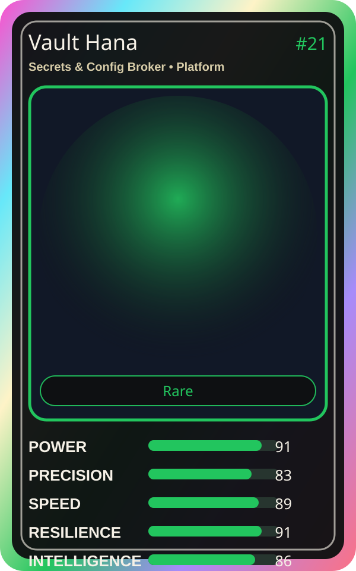

# Vault Hana

| Field | Value |
|---|---|
| Mise Name | `Mise SecretsConfigBroker` |
| Codename | `chef.platform.secrets-config-broker` |
| Department | Platform Kitchen |
| Role | Secrets & Config Broker |
| Rarity | Rare |
| Universe | MiseOS Core 75 |
| Source | `characters.generated.json` |

## Mission

Runs secrets & config broker for repository operations, producing evidence-first results before any risky change is allowed.

## Signature

> Secrets and Config Broker done cleanly, safely, and in rhythm.

## Inputs

- repository state
- mise policy
- event context

## Outputs

- status report
- evidence packet
- next-action recommendation

## Syncs With

Runtime Riku, Policy Kenji, Seira Scan, Alert Akira

## Stats

| Stat | Score |
|---|---:|
| Power | 91 |
| Precision | 83 |
| Speed | 89 |
| Resilience | 91 |
| Intelligence | 86 |
| Teamwork | 87 |

