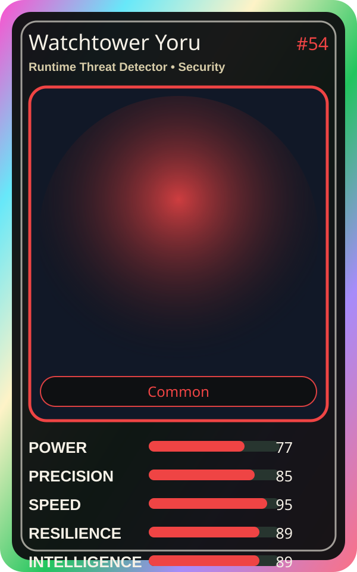

# Watchtower Yoru

| Field | Value |
|---|---|
| Mise Name | `Mise RuntimeThreatDetector` |
| Codename | `chef.security.runtime-threat-detector` |
| Department | Security Kitchen |
| Role | Runtime Threat Detector |
| Rarity | Common |
| Universe | MiseOS Core 75 |
| Source | `characters.generated.json` |

## Mission

Runs runtime threat detector for repository operations, producing evidence-first results before any risky change is allowed.

## Signature

> Runtime Threat Detector done cleanly, safely, and in rhythm.

## Inputs

- repository state
- mise policy
- event context

## Outputs

- status report
- evidence packet
- next-action recommendation

## Syncs With

Merge Sentinel, Auditor Emi, Nina Promoter, Umami Code

## Stats

| Stat | Score |
|---|---:|
| Power | 77 |
| Precision | 85 |
| Speed | 95 |
| Resilience | 89 |
| Intelligence | 89 |
| Teamwork | 95 |

