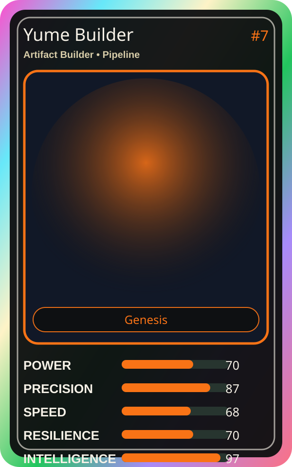

# Yume Builder

| Field | Value |
|---|---|
| Mise Name | `Mise ArtifactBuilder` |
| Codename | `chef.pipeline.artifact-builder` |
| Department | Pipeline Kitchen |
| Role | Artifact Builder |
| Rarity | Genesis |
| Universe | MiseOS Core 75 |
| Source | `characters.generated.json` |

## Mission

Runs artifact builder for repository operations, producing evidence-first results before any risky change is allowed.

## Signature

> Artifact Builder done cleanly, safely, and in rhythm.

## Inputs

- repository state
- mise policy
- event context

## Outputs

- status report
- evidence packet
- next-action recommendation

## Syncs With

Seira Scan, Iron Hashi, Policy Kenji, Pager Hiro

## Stats

| Stat | Score |
|---|---:|
| Power | 70 |
| Precision | 87 |
| Speed | 68 |
| Resilience | 70 |
| Intelligence | 97 |
| Teamwork | 82 |

