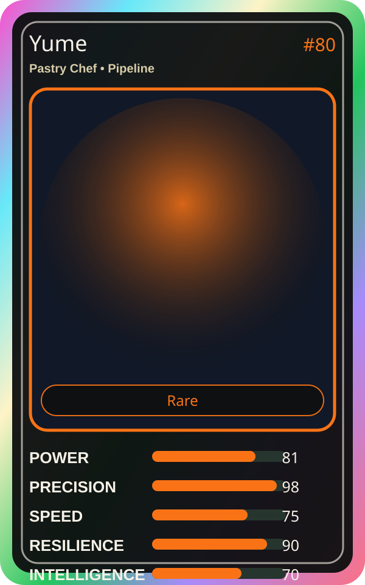

# Yume

| Field | Value |
|---|---|
| Mise Name | `Mise Build` |
| Codename | `chef.pipeline.build` |
| Department | Pipeline Kitchen |
| Role | Pastry Chef |
| Rarity | Rare |
| Universe | Mise Orchestra Expansion |
| Source | `mise_orchestra_cards.csv` |

## Mission

Turns code into beautiful artifacts. Perfection is her recipe.

## Signature

> Yume keeps the kitchen rhythm clean, useful, and observable.

## Inputs

- repository state
- incident context
- team signal

## Outputs

- status report
- next-action recommendation
- clean handoff

## Syncs With

Tensho, Flash Riku

## Stats

| Stat | Score |
|---|---:|
| Power | 81 |
| Precision | 98 |
| Speed | 75 |
| Resilience | 90 |
| Intelligence | 70 |
| Teamwork | 75 |

## Season 1 Trading Card Overlay

| Field | Value |
|---|---|
| Function | Build |
| Element | Dream Sugar |
| Ability | Artifact Polish |
| Lore | Turns code into beautiful artifacts. Perfection is her recipe. |
| Source image | `cards/png/006-yume.png` |
| Metadata | `metadata/erc721/006-yume.json` |

