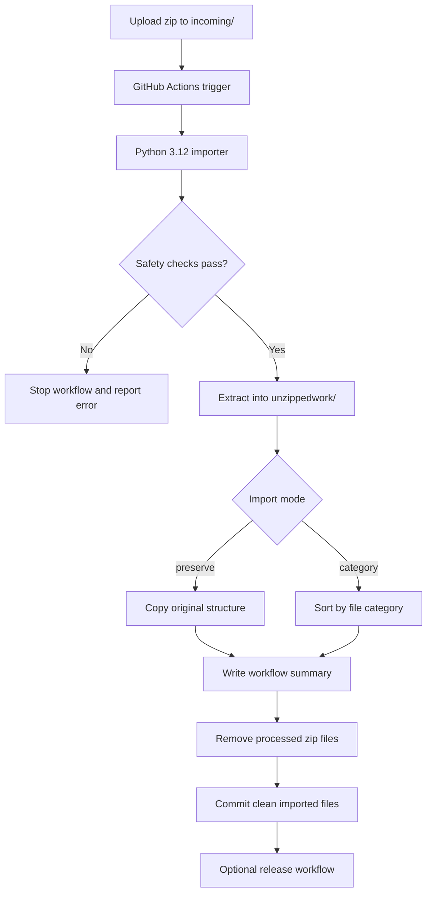

# Mise de Commis System

[](https://github.com/DeontewattsV1/Mise-de-commis-System-/actions/workflows/unzip-repository.yml)
[](https://github.com/DeontewattsV1/Mise-de-commis-System-/actions/workflows/release.yml)

A secure repository intake system for uploading `.zip` project bundles, validating them, extracting them safely, organizing their contents, and publishing clean release packages through GitHub Actions.

This repo acts like a controlled prep station: raw uploads enter through `incoming/`, the importer inspects and sanitizes them, and only safe, organized files are committed back into the repository.

---

## Control Panel

| Action | Where | Result |
|---|---|---|
| Upload a zip | `incoming/*.zip` | Triggers the import workflow on push to `main`. |
| Preview an import | Actions → `Import Uploaded Zip` → `dry_run: true` | Shows the file map without modifying the repo. |
| Preserve structure | Actions → `Import Uploaded Zip` → `mode: preserve` | Keeps the uploaded project layout intact. |
| Categorize files | Actions → `Import Uploaded Zip` → `mode: category` | Sorts files into `frontend/`, `backend/`, `docs/`, `assets/`, and related folders. |
| Publish release | Actions → `Package Repository Release` | Creates a GitHub Release with a zipped repository package. |

---

## System Map



---

<details open>
<summary><strong>Quick Start</strong></summary>

### 1. Upload a zip archive

Place your archive inside:

```text
incoming/
```

Example:

```text
incoming/project-update.zip
```

### 2. Push to `main`

```bash
git add incoming/project-update.zip
git commit -m "Upload project update zip"
git push origin main
```

### 3. Let GitHub Actions import it

The `Import Uploaded Zip` workflow will:

1. Validate the archive.
2. Reject unsafe paths or corrupt zip contents.
3. Extract into a temporary work directory.
4. Import files into the repo.
5. Remove the uploaded zip after success.
6. Commit the cleaned result back to `main`.

</details>

---

<details>
<summary><strong>Repository Layout</strong></summary>

```text
Mise-de-commis-System-/
├── .github/
│   └── workflows/
│       ├── release.yml
│       └── unzip-repository.yml
├── incoming/
│   └── .gitkeep
├── scripts/
│   └── unzipandorganize.py
├── .gitignore
└── README.md
```

### Important paths

| Path | Purpose |
|---|---|
| `incoming/` | Staging folder for uploaded `.zip` files. |
| `incoming/.gitkeep` | Keeps the upload folder tracked in Git. |
| `scripts/unzipandorganize.py` | Secure Python importer. |
| `.github/workflows/unzip-repository.yml` | Import automation workflow. |
| `.github/workflows/release.yml` | Manual release packaging workflow. |
| `unzippedwork/` | Temporary extraction directory ignored by Git. |

</details>

---

<details>
<summary><strong>Import Modes</strong></summary>

## Preserve mode

Preserve mode keeps the uploaded project structure intact. This is the safest default when imports include source code, application folders, relative imports, or dependency files.

Input:

```text
my-app/
├── README.md
├── Dockerfile
├── src/
│   └── main.py
└── tests/
    └── test_main.py
```

Output:

```text
README.md
Dockerfile
src/
└── main.py
tests/
└── test_main.py
```

## Category mode

Category mode mechanically sorts files into architectural buckets.

Output example:

```text
backend/
├── src/
│   └── main.py
└── requirements.txt
config/
└── Dockerfile
docs/
└── README.md
tests/
└── test_main.py
```

Use category mode for audits, asset sorting, unstructured drops, or intake cleanup.

</details>

---

<details>
<summary><strong>Security Model</strong></summary>

The importer is designed to treat every zip archive as untrusted input.

| Guardrail | What it protects against |
|---|---|
| Zip integrity testing | Corrupt archives and broken members. |
| Path traversal blocking | Malicious paths like `../../outside-file`. |
| Absolute path blocking | Attempts to write outside the repository root. |
| File count limit | Zip bombs with excessive file volume. |
| Total size limit | Oversized decompression payloads. |
| Single file size limit | Unexpected large file injection. |
| Ignored runtime folders | `.git`, `.github`, `node_modules`, `.venv`, `dist`, `build`, and cache folders. |
| SHA-256 duplicate checks | Identical files are skipped; changed duplicates are renamed safely. |
| Temporary work directory | Extraction happens in `unzippedwork/`, which is ignored by Git and cleaned after execution. |

Default thresholds:

```text
MAX_FILES = 2000
MAX_TOTAL_BYTES = 250 MB
MAX_SINGLE_FILE_BYTES = 50 MB
```

</details>

---

<details>
<summary><strong>Manual Workflow Controls</strong></summary>

## Import Uploaded Zip

Open:

```text
Actions → Import Uploaded Zip → Run workflow
```

Inputs:

| Input | Options | Default | Description |
|---|---|---|---|
| `mode` | `preserve`, `category` | `preserve` | Controls destination structure. |
| `dry_run` | `true`, `false` | `false` | Preview only when enabled. |

## Package Repository Release

Open:

```text
Actions → Package Repository Release → Run workflow
```

Inputs:

| Input | Example | Description |
|---|---|---|
| `tag` | `v0.1.0` | Release tag to publish. |
| `release_name` | `Mise de Commis System v0.1.0` | Human-readable release title. |
| `prerelease` | `false` | Marks the release as pre-release when enabled. |

Generated release asset format:

```text
mise-de-commis-system-v0.1.0.zip
```

</details>

---

<details>
<summary><strong>Local Validation</strong></summary>

Run the importer locally from the repository root:

```bash
python scripts/unzipandorganize.py --dry-run
```

Preserve mode:

```bash
MODE=preserve python scripts/unzipandorganize.py --dry-run
```

Category mode:

```bash
MODE=category python scripts/unzipandorganize.py --dry-run
```

Compile check:

```bash
python -m py_compile scripts/unzipandorganize.py
```

</details>

---

<details>
<summary><strong>Operational Notes</strong></summary>

- Keep `incoming/.gitkeep` committed so the intake folder always exists.
- Do not commit `unzippedwork/`; it is temporary and ignored by `.gitignore`.
- Use `dry_run` before importing large or unfamiliar zip files.
- Use `preserve` mode for application source code unless you intentionally want files categorized.
- Use releases to snapshot stable repository states after successful imports.

</details>

---

## Current Capabilities

- Secure zip validation.
- Safe extraction with repository boundary checks.
- Preserve and category import strategies.
- Duplicate detection with SHA-256 hashing.
- GitHub Actions workflow summaries.
- Automated cleanup of processed zip files.
- Manual release package publishing.

## Future Enhancements

- Add checksum manifest generation for each release asset.
- Add signed release provenance.
- Add configurable size thresholds through workflow inputs.
- Add import allowlists for stricter production repos.
- Add archive inventory reports as downloadable workflow artifacts.

---

## License

No license has been declared yet. Add a `LICENSE` file before distributing this project publicly.
