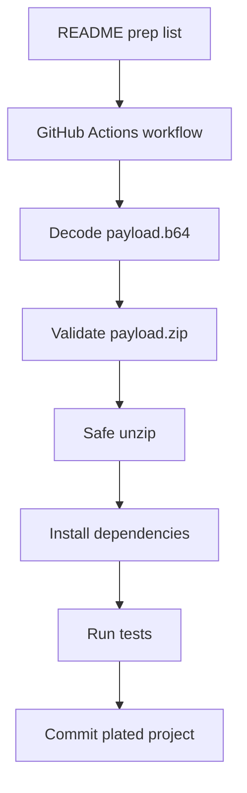

<p align="center">
  
</p>

<p align="center">
  
  
  
  
</p>

# Mise-en-Preplist Self-Unzip GitHub Bootstrap

A GitHub-ready bootstrap repository that works like a clean prep kitchen:

- the **README** is the prep list
- the **workflow** is the oven timer and expo rail
- the **payload zip** is the prepped ingredient box
- the **safe unzip script** is quality control
- the **final commit** is the plated project

Use this guide step by step. Do each station in order and check the boxes as you go.

---

## Brand Pantry

This repo includes a small brand kit so the project feels complete the moment it lands on GitHub.

```text
assets/brand/logo.svg
assets/brand/logo-dark.svg
assets/brand/logo-mark.svg
assets/brand/github-banner.svg
assets/brand/social-preview.svg
docs/BRAND_KIT.md
docs/REPO_COPY.md
docs/ASSET_INDEX.md
```

Use these assets for the README hero, GitHub social preview, repo avatar, release notes, and launch copy.

---

## Station Map

This repo starts small, then expands itself into a working project after you push it to GitHub and run the bootstrap workflow.

```text
README.md
.github/workflows/bootstrap-unzip.yml
.github/workflows/ci.yml
scripts/safe_unzip.py
bootstrap/payload.b64
bootstrap/payload-manifest.txt
docs/BOOTSTRAP_ORDER.md
.gitignore
LICENSE
```

When the prep run starts, GitHub Actions will:

- [ ] rebuild `bootstrap/payload.zip` from `bootstrap/payload.b64` when needed
- [ ] list the payload ingredients from `bootstrap/payload-manifest.txt`
- [ ] reject unsafe zip paths like `../secret` or absolute paths
- [ ] safely unpack the payload into the repo root
- [ ] install dependencies when `package.json` exists
- [ ] run tests when a test script exists
- [ ] write `.bootstrap/BOOTSTRAPPED`
- [ ] commit the expanded project back to the same branch

---

## Mise-en-Preplist

### Station 1 — Pull the ingredients

- [ ] Open this repository.
- [ ] Confirm the required prep tools exist:

```bash
ls README.md .github/workflows/bootstrap-unzip.yml bootstrap/payload.b64 scripts/safe_unzip.py
```

Expected result:

```text
README.md
.github/workflows/bootstrap-unzip.yml
bootstrap/payload.b64
scripts/safe_unzip.py
```

### Station 2 — Set up the GitHub kitchen

- [ ] Go to **Settings → Actions → General**.
- [ ] Under **Workflow permissions**, choose **Read and write permissions**.
- [ ] Save the setting.

This lets the bootstrap workflow commit the plated project after it unzips the payload.

### Station 3 — Run the prep service

Go to:

```text
Actions → Bootstrap Unzip → Run workflow
```

Use default settings first. The workflow will decode the payload, validate it, extract it, test it, and commit the expanded files.

### Station 4 — Confirm the plate

After the workflow finishes, confirm:

```text
.bootstrap/BOOTSTRAPPED
package.json
src/index.js
```

If those files appear, the self-unzip service worked.

---

## Correct Service Order



---

## Daily Operating Flow

Use this when replacing the payload with a real project:

1. Build or update your app locally.
2. Zip only the project contents, not the parent folder.
3. Convert the zip to base64:

```bash
base64 -i bootstrap/payload.zip -o bootstrap/payload.b64
```

4. Update `bootstrap/payload-manifest.txt`.
5. Commit the new payload files.
6. Run the bootstrap workflow again.

---

## Food Safety Rules for the Zip

The safe unzip script rejects:

- absolute paths
- `..` parent traversal
- unsafe symlink-like extraction paths
- files that try to escape the repository root

That keeps the workflow from unpacking files outside the repo.

---

## Operator Quick Reference

| Need | Go to |
|---|---|
| Understand the system | `README.md` |
| Run the self-unzip | `Actions → Bootstrap Unzip` |
| Replace payload contents | `bootstrap/payload.b64` |
| Review brand identity | `docs/BRAND_KIT.md` |
| Find launch copy | `docs/REPO_COPY.md` |
| Inspect asset paths | `docs/ASSET_INDEX.md` |
| Debug unzip behavior | `scripts/safe_unzip.py` |

---

## Brand Direction

```text
Mise-en-Prelist
Prep. Unzip. Test. Commit. Serve.

README → ACTIONS → PAYLOAD → TESTS → COMMIT
```
